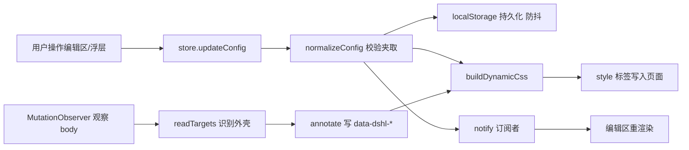
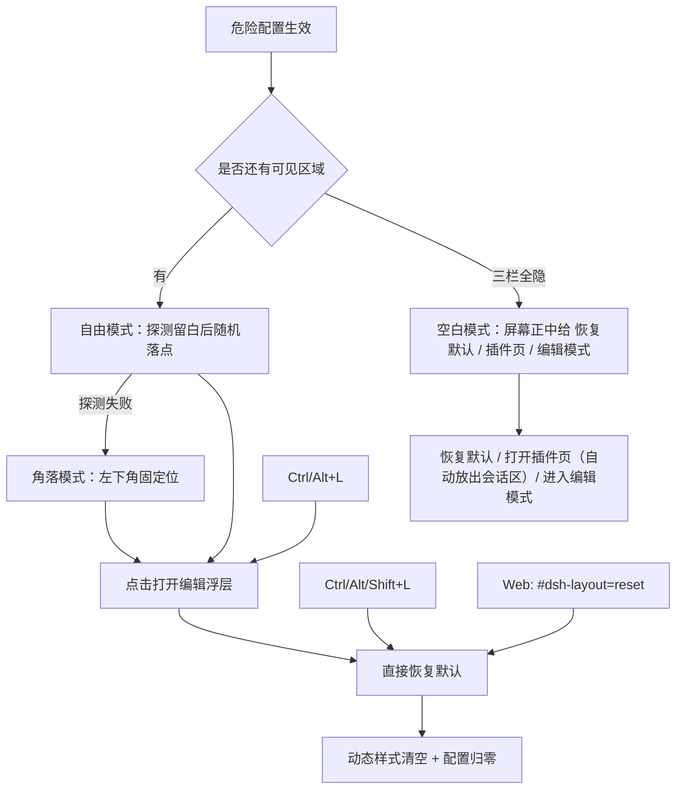

# 插件架构

## 组成

```text
bundle: dsh-layout（package.json 的 dsh.bundle.patch + dsh.client）
├─ Host 半边 index.js             只导出 apply()，占位；不注册服务、不写配置
└─ Client 半边 client.js          全部界面与布局逻辑
   ├─ 配置模型 / 本地持久化        localStorage: dsh-layout/config/v1
   ├─ DOM 注解器                   识别外壳结构，写 data-dshl-* 标记
   ├─ 界面结构识别                 官方登记 / 第三方登记 / 自动识别 三档
   ├─ 样式引擎                     按配置生成 style[data-dsh-layout="dynamic"]
   ├─ plugins.detail.section 注册  插件详情页内的编辑区
   └─ shell.overlay 注册           编辑模式：列分隔条、区域框、浮动工具条
```



## 设计选择

1. **不替换宿主组件。** 宿主 `root` 单插槽里是 AppFrame，替换它就要重写三栏、抽屉、拖拽手柄、主题呈现等全部行为，且会连带影响所有依赖子插槽的插件。因此只做两件事：给宿主 DOM 打标记、用 CSS 覆盖几何。
2. **入口按需求放在插件详情页。** `plugins.detail.section` 的 owner props 带 `subject`（`kind: 'bundle' | 'row' | 'item'`），组件只在 `pkg.name === 'dsh-layout'` 时渲染，不会污染其它插件的详情页。
3. **编辑浮层常驻注册。** `shell.overlay` 是框架级浮层，编辑模式在任意页面都能操作；浮层根节点 `pointer-events:none`，只有手柄与工具条可点，不挡住会话。
4. **配置存本地。** 布局是纯客户端呈现偏好，不进会话日志、不进 Host 配置，因此不需要重启插件、不触发 profile 重载；代价是桌面端与浏览器端配置独立，用导出/导入跨端同步。
5. **读取时全量校验。** localStorage 与导入文件都属于不可信输入，统一走 `normalizeConfig`：枚举项去重、未知项丢弃、数值夹取到合法区间，旧版本缺字段用默认值补齐。

## 界面结构识别（三档）

布局的对象不只是三栏，还有每一个「界面页面」：宿主自带的会话页/插件页，以及各插件贡献的面板页。识别分三档，人工登记优先、算法兜底：

| 档位 | 来源 | 维护责任 |
| --- | --- | --- |
| 官方（official） | 宿主外壳区域 + 宿主页面 + 官方插件页面，登记在 `OFFICIAL_PAGES` | DSH 每次升级后主动复核 |
| 第三方（third） | 已适配的第三方插件页面，登记在 `THIRD_PARTY_PAGES` | 逐个补充，没适配的自动降级 |
| 自动识别（auto） | 前两档都没命中时的兜底：iframe / `data-dsh-plugin` 等插件自留痕迹 | 算法承担，只判「第三方或未知」，绝不判官方 |

判定顺序：官方表 → 第三方表 → 自动识别。关键纪律是**未登记的页面永远不会被判成官方**——官方只有一份人工名单，不会因为「长得像」而误判。

- 页面身份用**签名**表达：`tag` + CSS 模块前缀 + `data-*` 名值对；iframe 用源前缀。优先用宿主/插件自己写死的 `data` 值（如 `data-plugin-panel="true"`、`data-dsh-plugin="task-board"`），CSS 模块哈希只作次要依据。
- **登记失配可观测**：缓存记住 `registeredTier`（上次命中登记的档位）。若某页曾由登记认出来、现在掉到自动档，卡片显示「签名变化，待复核」——这说明 DSH 升级或插件更新改了结构，该去复核登记表。这条直接对应「官方每次更新必须适配」的要求。
- **异常自动落盘 + 一键导出**：识别异常写入 `localStorage` 键 `dsh-layout/surface-anomalies/v1`，两类：`drift`（登记过但签名变了）与 `unregistered`（从未登记、只靠自动识别）。「界面结构」卡片底部「待复核清单」列出条目并提供「导出待复核清单」（JSON，含实测签名、观测时间、命中次数）与「清空」。导出文件可直接对照更新 `OFFICIAL_PAGES` / `THIRD_PARTY_PAGES`。异常在页面恢复正常登记时自动清除，清单不会堆积已解决的问题。
- 页面列表来自侧栏面板行（`aria-current="page"` 判当前页），只收 `button` 子节点，排除「更多」这类菜单触发器。

## 恢复通道（不可恢复状态防护）

布局可能改变「回到插件详情页」的路径，因此恢复能力必须独立于被改变的界面本身：



- 恢复入口的落点**不是固定位置**，且**不认识任何具体插件**：只依赖浏览器通用几何（元素矩形、可见性、可交互性）。第三方插件把控件放在哪里都只是一个矩形，算法一视同仁——这是「用户随时可能装新插件」的前提要求。
- 依附优先：测量整页（不只四个列区域，因为插件可渲染到 overlay/portal/body 直下），把同排控件按中心 y 归组，依附点必须落在该排跨度内且与所有占位矩形零相交；实测能稳定贴到表情包按钮、模型选择器这类工具栏空档。
- 遮挡守卫：DOM 变化后复查按钮矩形，被压住就递增 `reposition` 信号重算落点（1200ms 最小间隔防抖）。这条专门应对「未知插件在按钮之后才出现」。
- 空白模式把入口放在屏幕正中：这是最后一道「用户键盘失灵」的兜底，必须一眼可见、不必寻找。三枚按钮各自独立：恢复默认（回到宿主默认）、插件页（切到插件面板并自动放出被隐藏的会话区，因为插件页渲染在 main 面板里）、编辑模式（打开浮层，空白页下浮层无区域可框，工具条会提示「当前没有可见区域可拖拽」）。
- 快捷键与哈希重置不依赖浮层组件渲染，属于最后兜底；因此即使编辑浮层出问题也能恢复。
- 恢复按钮的点击还有一层不依赖样式的坐标命中兜底（document 捕获阶段监听 `pointerdown`/`mousedown`）。
- 设置面板偏移在生成样式时按视口夹取，面板不可能被配置到屏幕外。
- 折叠态（`:not([data-sidebar-collapsed])` 门控）不叠加本插件列序，避免「宿主列宽 + 本插件列序」错位造成的不可点击。

## 与宿主的交互面

| 交互 | 方式 |
| --- | --- |
| 读外壳结构 | 只读 DOM：`[data-slot="..."]`、`[data-rightbar-col]`、`[data-sidebar-right-panel]`、`[data-conversation-content]`、`[data-shortcut-modal="settings"]`、`aria-label` |
| 改几何 | 只写 CSS：自身 style 标签 + `data-dshl-*` 属性；不写宿主 inline style、不改宿主 class |
| 导航与路由 | 不改；仍由宿主负责（左栏面板切换、会话打开、设置开关） |
| 其它插件 | 通过宿主插槽共存；本插件不读取其它插件的样式或组件 |

## 升级稳定性

- 优先依赖宿主稳定的 `data-*` 属性与 `data-slot` 名称；CSS module 哈希类名一律作为兜底而非首选。
- 识别失败时 `targets.ok === false`，编辑区显示「未识别界面结构」，动态样式为空，界面维持宿主默认。
- 所有生成样式都限定在 `[data-dshl-frame]` 或 `[data-dshl-*]` 之下，不产生全局选择器，卸载时连同两个 style 标签一起移除。
