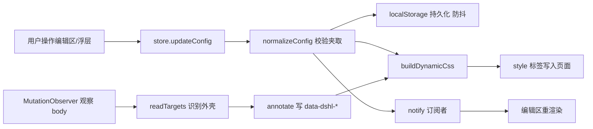
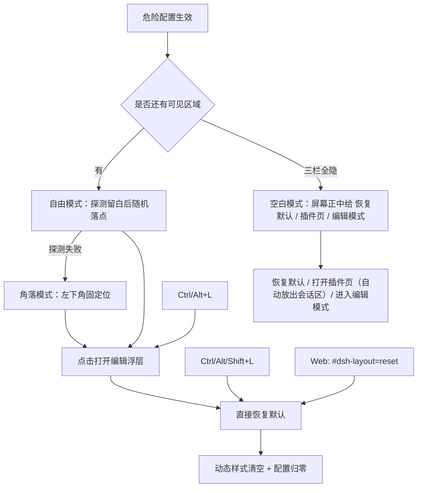

# 插件架构

## 组成

```text
bundle: dsh-layout（package.json 的 dsh.bundle.patch + dsh.client）
├─ Host 半边 index.js             只导出 apply()，占位；不注册服务、不写配置
└─ Client 半边 client.js          全部界面与布局逻辑
   ├─ 配置模型 / 本地持久化        localStorage: dsh-layout/config/v1
   ├─ DOM 注解器                   识别外壳结构，写 data-dshl-* 标记
   ├─ 界面结构识别                 官方登记 / 第三方登记 / 自动识别 三档
   ├─ 区域结构快照                 官方区域可见时记下单元清单与时间（area-snapshots/v1）
   ├─ 插件来源                     宿主 slots 注册表 + React fiber 定位组件条目
   ├─ 槽位编排                     可排列容器（宿主布局容器 + 列表槽位出口）与网格排列
   ├─ 区域搬移                     投影：源节点 fixed 定位 + 目标容器占位符 + 矩形差校准
   ├─ 联动                         条件规则叠加层（页面 / 折叠 / 区域 / 单元）+ 面板导航 ↔ 插件来源配置同步
   ├─ 入口收纳                     七区收纳域（三区原生「更多」+ 会话头注入宿主「更多操作」+ 三区授予式「更多」），入口自动发现
   ├─ 布局方案                     整套配置快照存成命名方案，切换即整套替换（localStorage，上限 20 套）
   ├─ 样式引擎                     按配置生成 style[data-dsh-layout="dynamic"]
   ├─ plugins.detail.section 注册  插件详情页入口（开关 + 概览 + 打开面板）
   └─ shell.overlay 注册           全局编辑面板（四类分页）+ 编辑模式层（列分隔条、区域框、工具条）
```



## 设计选择

1. **不替换宿主组件。** 宿主 `root` 单插槽里是 AppFrame，替换它就要重写三栏、抽屉、拖拽手柄、主题呈现等全部行为，且会连带影响所有依赖子插槽的插件。因此只做两件事：给宿主 DOM 打标记、用 CSS 覆盖几何。
2. **入口在插件详情页，编辑器在全局面板。** `plugins.detail.section` 的 owner props 带 `subject`（`kind: 'bundle' | 'row' | 'item'`），组件只在 `pkg.name === 'dsh-layout'` 时渲染，只放开关与「打开编辑面板」入口。编辑器本身常驻 `shell.overlay`，用 `react-dom` 的 `createPortal` 渲染到 `document.body`——设置页是 body 下的 fixed 弹层（z-index 1000），留在浮层里会被整层盖住；渲染到 body 后编辑面板与设置页同屏可操作。
3. **编辑模式与面板同属常驻浮层。** `shell.overlay` 是框架级浮层，编辑面板在任意页面都能打开；面板根节点标 `data-dshl-layer`，不参与编辑模式层的遮挡探测，也不挡会话。
4. **配置存本地。** 布局是纯客户端呈现偏好，不进会话日志、不进 Host 配置，因此不需要重启插件、不触发 profile 重载；代价是桌面端与浏览器端配置独立，用导出/导入跨端同步。
5. **读取时全量校验。** localStorage 与导入文件都属于不可信输入，统一走 `normalizeConfig`：枚举项去重、未知项丢弃、数值夹取到合法区间，旧版本缺字段用默认值补齐。

## 界面结构识别（三档）

布局的对象不只是三栏，还有每一个「界面页面」：宿主自带的会话页/插件页，以及各插件贡献的面板页。识别分三档，人工登记优先、算法兜底：

| 档位 | 来源 | 维护责任 |
| --- | --- | --- |
| 官方（official） | 宿主外壳区域 + 宿主页面 + 官方插件页面，登记在 `OFFICIAL_PAGES` | DSH 每次升级后主动复核 |
| 第三方（third） | 已适配的第三方插件页面，登记在 `THIRD_PARTY_PAGES` | 逐个补充，没适配的自动降级 |
| 自动识别（auto） | 前两档都没命中时的兜底：iframe / `data-dsh-plugin` 等插件自留痕迹 | 算法承担，只判「第三方或未知」，绝不判官方 |

判定顺序：官方表 → 第三方表 → 自动识别。关键纪律是**未登记的页面永远不会被判成官方**——官方只有一份人工名单，不会因为「长得像」而误判。

- 页面身份用**签名**表达：`tag` + CSS 模块前缀 + `data-*` 名值对；iframe 用源前缀。优先用宿主/插件自己写死的 `data` 值（如 `data-plugin-panel="true"`、`data-dsh-plugin="task-board"`），CSS 模块哈希只作次要依据。
- **登记失配可观测**：缓存记住 `registeredTier`（上次命中登记的档位）。若某页曾由登记认出来、现在掉到自动档，卡片显示「签名变化，待复核」——这说明 DSH 升级或插件更新改了结构，该去复核登记表。这条直接对应「官方每次更新必须适配」的要求。
- **异常自动落盘 + 一键导出**：识别异常写入 `localStorage` 键 `dsh-layout/surface-anomalies/v1`，两类：`drift`（登记过但签名变了）与 `unregistered`（从未登记、只靠自动识别）。「界面结构」卡片底部「待复核清单」列出条目并提供「导出待复核清单」（JSON，含实测签名、观测时间、命中次数）与「清空」。导出文件可直接对照更新 `OFFICIAL_PAGES` / `THIRD_PARTY_PAGES`。异常在页面恢复正常登记时自动清除，清单不会堆积已解决的问题。
- 页面列表来自侧栏面板行（`aria-current="page"` 判当前页），只收 `button` 子节点，排除「更多」这类菜单触发器。

## 区域界面拆解

「拆解」= 把某个区域认成更小的可控单元，让它们能独立显隐与互换位置。目前覆盖四个区域。

### 侧栏

| 单元 | 判定方式 |
| --- | --- |
| 品牌标识 | 品牌行里含 `[data-slot="sidebar.brand.mark"]` 的直接子级（按钮，图标 + 名称） |
| 收起按钮 | 品牌行里含 `[data-sidebar-toggle]` 的直接子级 |
| 状态按钮行 | 底部区里含 `[data-slot="sidebar.footer.action"]` 的直接子级 |
| 账号菜单 | 底部区里含 `[data-slot="sidebar.settings"]` 的直接子级 |

- 「直接子级」由锚点向上走到块的子级得到（与右栏同一套求法），中间多一层包裹不影响识别。
- 四个单元各自 `display:none`，互不影响。实测隐藏状态按钮行后底部区从 138px 收到 52px，再隐藏账号菜单后归 0。
- 品牌行只有两个直接子级，所以能单独隐藏任一：隐藏品牌标识只留收起按钮（仍可折起侧栏），隐藏收起按钮则保留标识。
- 拆解只碰宿主容器（品牌行、底部区、状态行、账号区），第三方插件塞进状态行的按钮只作为容器内容一起显隐；插件换版本不受影响。
- 账号菜单同时是设置入口（`settings.launcher`）：隐藏后设置仍可用 `Ctrl/⌘+Alt+,` 打开，属用户显式选择，不做额外拦截。

### 会话区

| 单元 | 宿主结构与判定 |
| --- | --- |
| 会话头 | `[data-slot="conversation.header"]`（`display:contents`）里的 `header` 元素，才是真正的 flex 项 |
| 消息区 | `[data-slot="conversation.session"]`，位于 `._scrollBody_` 下 |
| 输入区 | `[data-slot="conversation.composer"]` 的父元素 `._composerSeat_`，本身是 `position:sticky` 的 flex 项 |

- 可做的操作：三块**独立显隐**；会话头与正文**换前后**（`convroot` 上设 `order`）；输入区**提到消息区上方**（`convscroll` 上设 `order:-1`）。
- 提到上方时必须同时把输入区的 `position:sticky; bottom:0` 改成 `sticky; top:0`，否则它会跟着滚动内容一起跑出可视区——这是实测踩到的坑。
- 会话头内部再拆两行：**标题行**（面包屑 + 会话操作 + 工具 + 角标）与**视图标签行**（对话 / 轨迹等视图切换）。两行都是 `conversation.session.header` 槽位的元素子级；视图标签行按通用 ARIA 标记 `role=tablist` / `role=tab` 认，剩下那行就是标题行——不依赖 CSS 模块类名，宿主加视图也不受影响。
- 标题行内部再拆两段：**会话名**（面包屑，`conversation.session.header.lineage`）与**操作组**（智能体团队 / 权限等，`conversation.session.header.actions`）。两者同属标题行里的 titleCluster，按槽位各自向上取直接子级；隐藏会话名后操作组左移到原会话名位置，标题行高度不变。
- 输入区内部再拆两段：**任务面板**（待办清单，宿主写死的 `data-testid="todo-panel"`）与**状态条**（输入卡下方 `conversation.composer.dock` 槽位所在行，第三方插件塞的轮数 / token / 人设胶囊都在这里）。两者都只在有内容时渲染；实测隐藏状态条后输入区 170 → 144。
- 消息区内部再拆一段：**轮次导航**（右侧竖排轮次标记）。结构是消息区 → viewArea → `conversation.view` 槽位 → frame，frame 的两个直接子级里含 `conversation.chat.flow` 的是消息流，另一个就是导航槽；额外校验导航槽里真的含 `nav`，避免把别的覆盖层当成导航。隐藏后导航尺寸归零、消息流布局不变。
- 排版坑：会话头是 grid，宿主写死了 `grid-template-rows: 32px 35px` 与 `min-height: 76px`。只给一行 `display:none` 高度不会变，必须同时把行高交还 `auto` 并撤掉 `min-height`（实测隐藏标题行 78→46，隐藏标签行 78→43）；两行都隐藏时会话头整体 `display:none`。
- 视图标签行可以**放到标题行上方**。这里不能用 `order`：会话头是两列网格（第一列是 0px 的 leading），`order` 会让标签行落进 0px 列。正确做法是显式指定行列——行高交还 `auto auto`，标签行写 `grid-column:2; grid-row:1`、标题行写 `grid-column:2; grid-row:2`（实测标签行 y=20、标题行 y=45）。
- 拆解结果全部是 CSS `order` / `display` 覆盖，不改 React 树、不移动 DOM，宿主自身的滚动与粘贴行为不受影响。

### 右栏

| 单元 | 判定方式 |
| --- | --- |
| 标签栏 | 由 `[data-slot="sidebar.right.pane.tab.title"]` 向上找到「共同父的直接子级」 |
| 内容区 | 由 `[data-slot="sidebar.right.pane.tab"]` 同上定位 |

两个分支同父（`._tabHost_`，flex column），所以可各自隐藏，也可上下互换（`order` 互换）。定位不用 CSS module 哈希类名：先求两个 slot 的最近公共祖先，再各自向上取该祖先的直接子级，插件换构建也照样成立。

### 设置页

| 单元 | 判定方式 |
| --- | --- |
| 导航列 | 标题行（含 `settings.header` 的子级）+ `NAV` 元素，作为一个整体显隐 |
| 页头 | 含 `settings.action` / `settings.close` 的子级 |
| 选项区 | 含 `settings.section` 的子级 |

四个子级（标题、导航、页头、选项区）落在命名网格区域 `"title header" / "nav options"` 上，所以不能只改列宽——隐藏导航后左侧会留一条空轨道。正确做法是**重写区域名并给子级重新指派 `grid-area`**：

- 隐藏导航：`grid-template-columns: minmax(0,1fr)`，区域改为单列 `"dshlHeader" "dshlOptions"`（页头也在时）；只剩一块时再收成单行。
- 导航右置：`grid-template-columns: minmax(0,1fr) <导航宽度>`，区域改为 `"dshlHeader dshlTitle" "dshlOptions dshlNav"`。导航宽度优先用配置值，用户没设过时现场量一次真实值。
- 隐藏页头：选项区跨两行上移（`"dshlTitle dshlOptions" "dshlNav dshlOptions"`），内容对齐面板顶部；实测选项区从 y=78 上移到 y=24、高度 588→642。
- 折叠成单行时**必须同时把 `grid-template-rows` 交还 `minmax(0,1fr)`**：宿主留的是两条轨道（54px + 剩余），只改列会让内容只占上半截。实测「只剩页头」「只剩选项区」两种情况都铺满整个面板。
- 导航与内容侧都隐藏时不再重写网格，只让四块 `display:none`。

### 共同约定

- 结构识别成功后写入区域快照 `dsh-layout/area-snapshots/v1`（`{ at, ids }`，按区域分键）：识别层只能看见「此刻渲染在 DOM 里」的那一层界面，会话区/右栏/设置面板不常驻 DOM，离开该页后只能靠快照说明「上次观测的结构与时间」。升级前的 `conv-parts/v1`、`aux-parts/v1` 布尔标记保留用于迁移：没有快照时提示「曾识别过，但没有结构快照」。
- 快照写入时机：区域从不可见变为可见、可见单元清单变化、或连续可见超过 30 秒刷新一次时间；不存元素引用。

### 拆解层：统一声明表与覆盖度

拆解不再是「每个区域一套识别 + 一套样式 + 一套卡片」，而是收敛成一张声明表 `PART_UNITS`（24 个单元）：

| 字段 | 作用 |
| --- | --- |
| `id` | 统一标记 `data-dshl-unit="<id>"`；隐藏样式、覆盖度都按它定位 |
| `area` / `section` | 所属区域与卡片分组（`PART_SECTIONS`） |
| `kind` | `hide`（显隐）或 `order`（换序/换边） |
| `path` | 配置路径，卡片读写只走这一处 |
| `targets` / `needs` / `after` | 复合隐藏目标、换序所需单元、写入后的联动 |

各区域识别器只负责把元素认出来（汇总成 `targets.units`），其余全部从声明表派生：

- **标记**：`annotate` 遍历 `targets.units` 写 `data-dshl-unit`，旧的分属性（`data-dshl-part/hpart/cpart/mpart/rbpart/setpart/sbpart`）已全部取消。
- **样式**：所有 `hide` 单元的选择器由声明表生成；换序、命名网格等结构规则手写，但同样只引用统一标记。
- **卡片**：`PartSection` 按 section 渲染说明 + 开关，`PartRow` 按 `path` 读写配置——新增单元只加一条声明，不改三处。
- **覆盖度**：编辑器新增「拆解覆盖」卡片，逐个列出 24 个单元的状态，三态按「此刻是否真的在 DOM 里」区分：**此刻在场**（这一秒命中）/ **上次观测**（不在场，但上次打开该区域页面时的快照里有它，带时分）/ **上次未出现**（有快照但当时没有该单元）/ **从未识别**（还没打开过那个页面）/ **无快照**（升级前只记过布尔）。DSH 升级改掉某个结构时，这里会直接指出来。

### 外部插件自动拆解（只读发现）

官方区域的拆解是「预先登记」的；第三方插件没有登记结构，因此另开一条**通用扫描**链路，不针对任何具体插件：

| 步骤 | 做法 |
| --- | --- |
| 页面定位 | 从 `[data-slot="main"]` 找第一个真实布局盒，跳过零尺寸/`display:contents` 包裹；单子级包裹逐层收拢（滚动容器不要求子级同高）；iframe 占据页面主要面积时判为 iframe 页（不做内部拆解） |
| L1 区域 | 页面根的直接子级：`header / footer / aside / row / scroll / main`，装饰性覆盖层（绝对/固定定位、不可交互、无文字）直接跳过 |
| L2 单元 | 区域里「成组」的直接子级：尺寸一致的重复结构、`role=tablist/toolbar/nav/list/grid`，或区域本身是 main/aside/scroll；普通页头里的零散按钮与标题不拆 |
| 可拆性判定 | 四档输出：可隐藏 / 可排序 / 可调尺寸 / 只读。唯一滚动容器、含输入控件、入口类、占满整页都进「只读」；入口只给排序与尺寸，不给隐藏 |
| 三档来源 | **声明（declared）**：插件在节点上写 `data-dshl-declare`，直接采用；**登记（registered）**：人工「登记此页结构」后，键匹配的单元升档；**自动（auto）**：通用启发式。声明优先于登记，登记优先于自动 |
| 分类模板 | 按结构判页面类型：有分栏项→看板、有概览行→仪表盘、有标签项→标签页、只有滚动区→滚动页、有页头→列表页、其余通用；再归出语义组（声明单元 / 页头 / 概览行 / 标签组 / 分栏组 / 主体 / 侧栏 / 页底），支持整组隐藏 |
| 分级操作 | 安全项（区域带、重复组、声明与登记项）接入配置：隐藏开关 + 上移/下移改 `order`；风险项只显示原因，不给隐藏开关。配置键 `pageKey::unitKey`，存 `config.external.hide` / `config.external.order` |
| 失效清理 | 页面扫描成功后，删掉该页配置里已不存在的单元键；只在该页真的扫出单元时清理，避免加载中途的空扫描误删 |
| 登记闭环 | 「登记此页结构」把当前扫描写入 `dsh-layout/plugin-units-registry/v1`，后续扫描该页时命中键升为登记档；「清除登记」可撤销 |
| 持久化 | 扫描结果按 pageKey 存 `dsh-layout/plugin-units/v1`（最近 12 页），覆盖度面板展示；「导出候选清单」给出 JSON，供人工登记与模板化 |
| 反馈 | 扫描结果纳入识别签名，页面切换即刷新卡片；编辑面板是浮层，切到哪个页面就扫哪个页面，不在插件页时回退显示最近一次扫描结果（带扫描时间） |

插件自声明契约（可选，给愿意配合的插件作者）：

```html
<div data-dshl-declare="header" data-dshl-declare-label="顶部栏">…</div>
<div data-dshl-declare="main" data-dshl-declare-guard>…</div>
```

- `data-dshl-declare` 的值是单元类型（`header/main/aside/footer/toolbar/list/tab-bar` 等，仅作标签）；
- `data-dshl-declare-label` 可选，作为显示名；
- `data-dshl-declare-guard` 表示受保护单元：只给排序与尺寸，不给隐藏；
- 声明单元不参与启发式扫描（避免重复），标记键为 `D<序号>`。

扫描深度固定 2 层（区域 → 区域的直接子级），入口判定为「以导航/切换为主要目的的单元」，一个带标题与按钮的页头不算入口。操作只做 `display`、`order` 两类可逆覆盖，不注入交互。

## 插件来源（组件级拆解）

外部插件的结构此前只能靠几何扫描猜。宿主 slots 服务提供了权威的注册表：谁在哪个槽位注册了什么。插件来源层把两路数据合起来：

| 来源 | 拿到什么 | 稳定性 |
| --- | --- | --- |
| slots 注册表（`ctx.get('slots')`） | `snapshot()` 的槽位树（实测 112 个槽位、约 400 个条目）+ `entries(key)` 的 `id / order / registrant / component` | 运行时可用；`entries/snapshot` 不在 slots 服务声明的三个方法里，属内部接口 |
| React fiber | 用注册表里的组件函数引用在 fiber 树里做同一性匹配，找到已渲染条目的宿主节点；再上探到按钮/菜单行作为可操作目标 | 依赖 React 内部字段（`__reactContainer$`、带随机后缀的 fiber 键） |

合并后的能力：

- **清单**：按槽位分组列出条目（id、注册者、顺序、是否渲染）；默认只显示「有已渲染可操作条目」的槽位，可切「显示全部槽位」看只读与未渲染项；顶部搜索框按槽位键 / 条目 id / 注册者 / 组件名过滤（槽位键命中时整组保留）。
- **精确操作**：已渲染条目打 `data-dshl-slotentry="<槽位>::<条目id>"`，隐藏与排序各生成一条 CSS，不再按 DOM 位置猜。排序有两条等价入口：拖拽行（同槽位内换位）与箭头按钮（与相邻行交换），都走同一条「写 0..n-1 序号」的序列，顺序完全由配置决定、不再依赖宿主注册优先级。
- **分级**：列表类槽位可隐藏 + 排序；入口类（侧栏面板图标、标签页、菜单项）只排序；页面主体（`main`）、单槽、弹层类条目只读。`dsh-layout` 自身的条目自动排除。
- **多 React 根**：设置弹层挂在 body 下的独立 React 根里，定位时遍历 `#root` 与 body 直接子级里所有 `__reactContainer$`，否则弹层内组件永远匹配不到（实测未修前设置页 21 个 section 全部「未渲染」）。
- **降级**：槽位服务不可用或 fiber 失效时卡片显示说明，页面内部的几何拆解照常工作。

边界：未渲染条目没有 DOM（只能列出、不能操作）；页面内部未注册到槽位的组件仍走几何拆解或自声明；`registrant` 对动态加载的包常是同一个宿主 id，不能当插件身份用；弹层/菜单类条目隐藏后可能断功能，统一只读。

配置：`slots.hide`（键列表）与 `slots.order`（键→顺序），与外部插件单元同一套可逆覆盖。

## 槽位编排（区内排列）

「插件来源」解决「条目能不能动」，槽位编排解决「同一容器里怎么摆」。核心是**容器**这个新对象：

| 容器来源 | 判定 | 例子 |
| --- | --- | --- |
| 已知布局容器 | 注解器已经认出的宿主块 | 侧栏面板导航 `panels`、侧栏底部 `sidebar-footer`、右栏标签栏 `rightbar-tabs`、设置页导航 `settings-nav` |
| 列表槽位出口 | 列表槽位里 ≥2 个已渲染条目的最近公共父级，id 为 `slot:<槽位键>` | `slot:sidebar.footer.action`、`slot:conversation.hero.options` |

- 容器打 `data-dshl-arrange="<容器 id>"`；样式只做一件事：`display:grid` + `grid-template-columns: repeat(N, minmax(0,1fr))` + `gap`，行内补 `min-width:0`。
- 已知容器可能只是外层包裹（设置页导航列的真正列表是它内层的唯一子元素），解析时向下穿「只有一个子元素」的包裹，直到真正装条目的列表；最多穿 4 层，穿不动就用原节点。
- 配置 `arrange`：容器 id → `{ columns: 2..3, gap: 0..32, compact }`；只收 2/3 列（1 列等于关闭，不落配置），容器数量上限 12，未知字段丢弃。
- **为什么不用 `order` 做排列**：`order` 只换顺序，换不出多列；容器又不是每种都是 flex（`display:contents` 的槽位出口根本没有自己的布局盒），必须先把容器变成网格容器，才能谈列。`order` 仍归「插件来源」的排序用，两者叠加（网格项也吃 `order`）互不冲突。
- **只留图标**只对 `panels` 开放：规则是隐藏行内第二个子元素并让行居中，靠结构位置而不是类名；其它容器第二个子元素可能是控件，误藏会断功能。
- **过滤规则**：浮层/菜单/弹层类槽位（`overlay|contextmenu|menu|popover|tooltip|dialog|toast`）不参与排列；零尺寸、`display:none` 的容器不算可排列（`display:contents` 按第一个有尺寸的子元素判断）。
- **不在场可调**：已配置但此刻不可见的容器（例如设置页没打开时的 `settings-nav`）仍列在卡片里，标「此刻不在场」，可以改配置或复位。
- 部署边界：容器换掉/结构变化时，标记自动撤到新节点；配置对不上时只是没有可命中的样式，宿主布局保持原样。

## 区域搬移（投影）

「把品牌行搬进设置页」这类跨区域搬移，走的是**投影**：不移动 DOM 节点，只移动「看见的位置」。三条别的路都被堵死了：

| 路线 | 为什么不用 |
| --- | --- |
| 目标处再渲染一份宿主槽位 | 子槽位 key 全局独占声明（`SlotCore.register` 重复声明直接抛错），`renderSlot` 只发给声明者 |
| 改条目 order / 真移动 | 宿主没有移动接口；order 只在注册时排序一次 |
| 真搬 DOM 节点 | React 18 把事件委托挂在 root 容器上，节点搬走后宿主列表增删同级条目会在 commit 阶段抛 `NotFoundError`，搬出容器还会丢合成事件 |

投影的三件套：

| 元素 | 做法 |
| --- | --- |
| 源节点 | 加 `data-dshl-teleport`，CSS 里 fixed 定位 + `z-index:1100`（高于设置弹层 1000、低于编辑面板 1250），宽度取目标宽度、位置用 `--dshl-tx/--dshl-ty` 平移 |
| 占位符 | 本插件创建的 `data-dshl-placeholder` 插进目标容器（开头/结尾），参与目标区布局，高度跟随源节点；只在编辑面板打开时画虚线框 |
| 校准 | 帧循环比较「占位符矩形 − 源节点矩形」，宽度先对齐（宽度影响换行与高度），再补位移；差值收敛后停帧，滚动/缩放/识别变化各触发一次；最多追 240 帧防抖动常驻 |

- 源始终留在原 React 树里：事件、宿主逻辑、Store 订阅都不受影响；代价是它不参与目标区的父级布局，只由占位符让位。
- 目标不在场或零尺寸（如右栏收起）→ 投影不建立，源留在原位；卡片上标「目标不在场，暂不生效」。这就是本轮「条件搬移」的实际形态，显式条件规则留给第三期。
- 源节点被 React 重建时，下一轮识别会重新解析并重建投影；移除配置/关闭插件时占位符与内联变量一并清掉，不留 `style` 空属性。

## 联动（条件规则 + 配置同步）

联动不新增运行时机制，而是把已有能力按条件叠加：

| 部分 | 做法 |
| --- | --- |
| 条件源 | 当前页面（设置页 > 会话页 > 插件详情页 > 外部插件页 > 插件页）、侧栏折叠、区域在场（四区）、单元在场（侧栏块 / 拆解单元 / 槽位条目） |
| 动作 | 隐藏（块 / 拆解单元 / 槽位条目，各自按标记生成 `display:none`）、容器排列（叠加或覆盖基础排列） |
| 生效方式 | `computePlan(targets, config)` 合成「基础配置 + 命中规则的叠加层」，样式与投影只认 plan；条件随识别每轮重算，因此切页面、折叠侧栏时规则即时生效/失效，不留下残余规则 |

规则与基础配置互不破坏：规则命中只往 plan 里加东西，规则不命中就等于不存在；基础配置的卡片开关仍表示「基础值」。

配置同步解决一个真实冲突：面板导航按 `aria-label` 给 `[data-dshl-panel]` 写 `order`，插件来源按条目键给 `[data-dshl-slotentry]` 写 `order`，而这两个属性落在同一排图标上——两套配置不一致时谁后写谁赢。开启同步后，两侧的排序与隐藏写同一份配置（`panels ↔ sidebar.panellist` 按 DOM 里的一一对应映射），视觉与配置都不再互相覆盖。

## 入口收纳（收起入口到各区的「更多」）

侧栏面板图标越装越多，常用的只有几个。收纳按「收纳域」工作：一个能自动发现入口的列表 + 一个宿主原生的「更多」菜单，把不常用入口从列表收起、改由「更多」菜单提供。

| 收纳域 | 入口自动发现 | 收起方式 | 菜单与打开方式 |
| --- | --- | --- | --- |
| 侧栏面板 | `sidebar.panellist` 槽位条目（面板 id + 显示名） | `[data-dshl-panel]` 生成 `display:none` | 原生 `sidebar.panellist.actions` 注册行 → `layout.selectPanel(panelId)` |
| 会话视图标签 | `conversation.view` 槽位条目（id + 本地化标签；`chat` 不参与） | 按列表 key（= 视图 id）打 `data-dshl-stored-view` | 原生 `conversation.session.header.views.actions` → owner `onOpen(id)` |
| 右栏开始页卡片 | DOM `[data-sidebar-right-guide-entry]`（值 = 入口 kind，同一时刻唯一；`files` 不参与） | 按 kind 打 `data-dshl-stored-guide` | 原生 `sidebar.right.tab.guide.actions` → owner `onOpen('kind:id')` |
| 设置页导航（授予式） | `settings.section` 槽位条目（id + 显示名，当前约 22 项） | 按列表 key（= 分区 id）给导航行打 `data-dshl-stored-section` | 导航列表末尾插外来锚点（抄原生 navCell 类名）→ 宿主 `Menu` → 按 id 点原生导航行切 section |
| 插件页第三方插件（授予式） | DOM `[data-plugin-package]` 卡片（包名 + 标题） | `[data-plugin-package="<包名>"]` 直接 `display:none` | 「已安装插件」分组标题旁插外来锚点（抄原生 `groupMore` 类名）→ 宿主 `Menu` → 点卡片打开按钮进详情 |
| 会话头工具按钮 | DOM 工具行里的 `button`（身份：槽位条目键 → 列表 key → 业务组件名 → 显示名） | 注解层打 `data-dshl-stored-button`，动态样式收起 | 注入宿主「更多操作」菜单：点锚点后等菜单出现，向 `[role="presentation"]` 末尾追加行 → 点行 `.click()` 原按钮 + Escape 关菜单；宿主按钮不在场时才退回授予式锚点 |
| 设置页页头操作（授予式） | DOM `settings.action` 行里的 `button`（同一套身份规则） | 同上 | 页头操作行末尾插外来锚点（抄原生按钮类名，带「更多」文字）→ 宿主 `Menu` → `.click()` 原按钮 |

**身份键**：四类需要「记住是哪一个入口」的区不再靠显示名匹配。DOM 侧按「槽位条目键（自身或向上 3 层祖先）→ React 列表 key（宿主渲染列表时用的条目 id）→ 最近业务组件名 → 显示名」取第一个可用值；配置里存稳定键（视图与设置导航直接存槽位 id，开始页存 kind，按钮存槽位键或 `comp:<组件名>`），匹配时任一键命中即算同一入口。显示名只用于展示，以及「早期只有名字的条目」和按钮旧 `label:` 键的兜底。宿主改文案不再影响收纳状态。「更多操作」按钮是会话头收纳的入口本身，不参与自动发现与收纳。

- 收纳行用宿主 `@deepseek-ai/dsh-client-ui-primitives` 的 `MenuItemButton` 渲染；原生三区 order -100 排在各菜单最前，授予式三区自带 `Menu`。
- 会话头的收纳行不新开菜单，而是注入宿主「更多操作」菜单：按钮点击后轮询等新菜单出现，行的 className 从菜单现有行运行时抄（宿主类名是哈希）；宿主每次打开菜单都重建 DOM，所以每次重新注入、不会重复。行点击后 `.click()` 原按钮并派发 Escape 关菜单（宿主菜单不会自己关，因为有外部行被点）。
- 授予式的锚点由组件维护：容器出现/重建时自动重挂（900ms 轮询兜底），组件卸载时移除；配置为空或 primitives 缺失时锚点不出现。
- 宿主内部三套 Pin 机制（侧栏面板 / 会话视图 / 开始页卡片）都只存在内存、刷新复位，且只经各自条目 inject 暴露，本插件不依赖它们；收纳状态写自己的配置。
- 边界：宿主保留的入口（侧栏「插件」、`chat` 视图、开始页「文件」、会话头「更多操作」）不参与收纳，保证收起后永远有路可回；关闭「启用自定义布局」时菜单不出收纳行；授予式与注入都依赖宿主的结构/类名，宿主大版本改版后退化为锚点不出现或注入落空（收纳项仍在原列表位置之外，关掉配置即可复原）。

## 布局方案（整套配置快照）

写死的 5 个预设只是起点模板（点一下覆盖一次），用户自己调好的整套布局存不下来。布局方案补上这件事：

- **方案 = 一份 `normalizeConfig` 校验过的完整配置**，存在 `localStorage` 键 `dsh-layout/layouts/v1`：`{ active, list: [{ id, name, savedAt, config }] }`，上限 20 套。
- **应用走既有入口**：`replaceConfig(整套配置)`——与「恢复默认」「导入 JSON」同一条链路（校验 → 持久化 → 重算样式 → 通知），不新增第二套应用路径。
- **配套操作**：存为新方案、用当前配置覆盖某套、行内改名、删除；`active` 只记录「从哪套改来的」，用户手动改配置后不清空。
- **与预设的关系**：预设行保留（模板，不落库），方案卡片并列在「布局结构」分页顶部；卡片描述明确写「切换是整套替换」，避免误解成字段合并。
- **读取即规范**：条目结构不完整的丢弃、`config` 重新过 `normalizeConfig`、超 20 套截断并写回——存储与界面不会长期不一致。
- **边界**：不做方案自动切换（按页面自动切属于联动规则，已有机制）；不做方案级导入导出（配置层已有整体导出/导入）。

## 持久化（配置跟着 DSH 走，不跟着浏览器走）

布局配置与布局方案是用户调了很久的成果，不能因为换浏览器、换 Web 端、清缓存就归零。所以主存储放在**宿主侧**，浏览器只做渲染缓存：

| 层 | 位置 | 职责 |
| --- | --- | --- |
| Host 侧声明（`index.js`） | schemastery `Config { document, schemes }`（两个 `.volatile()` 的 JSON 字符串）+ `ctx.settings.configure({ auto: false }, ctx.fiber)` | 让宿主认得本插件有一个可持久化配置节，命名空间 = 插件行 id `layout` |
| 主存储 | 当前 profile 的 `cordis.patch.yml` 里的 `- id: layout` 节 | 宿主每次启动都会应用；与浏览器无关，换浏览器/清缓存都在 |
| 渲染缓存 | `localStorage` 的 `dsh-layout/*` | 启动即用，避免等异步读盘时闪默认布局；宿主不可用时它就是唯一存储（降级） |
| 读写通道 | 客户端 `ctx.configForms.get('layout')` | `getSnapshot()` 读、`subscribe()` 订阅、`set(field, text)` 写；落盘与并发由宿主负责 |

- **字段是字符串不是结构化对象**：配置字段随版本演进（storage / arrange / relocate / rules / sync / schemes），每加一层都要同步 schema，而 schema 校验失败会让整节配置被宿主丢弃。客户端的 `normalizeConfig` 已是权威校验，schema 只做字符串粗校验。
- **只 volatile 字段可写**：当前版本的 `dsh-settings` 用 `isVolatilePath` 校验写入路径，没有 `.volatile()` 标记的字段会被拒绝。
- **回环与并发**：`hostLastWritten` 记住已写入的字符串，读回到自己写的值直接跳过；`hostWriteChain` 串行化写入；`writable === false` 的部署不发写请求。
- **首次迁移**：宿主该字段为空时（升级到宿主存储的第一天），客户端把 localStorage 里的现值推上去，避免「用户不改任何设置就永远带不走旧配置」。
- 落盘位置**不是** `~/.dsh/settings.yaml`：那份文件在当前版本已被废弃，只剩一次性导入迁移（导入后改名 `.imported`）。判断依据只能取当前 `D:\DSH` asar 里的包，本机 `D:\deepseek-harness` 是停滞的旧源码。

## 编辑面板（全局浮层）

编辑器原来嵌在插件详情页里，而识别层只能看见「当前渲染在 DOM 里」的那一层界面：在详情页上，会话区/右栏/设置页都不在 DOM 里，卡片只能靠声明表与「见过」布尔出控件，调的时候看不到效果；设置页浮上来时虽然识别得到，详情页却被压在下面。**能识别的时候看不见，看得见的时候识别不到。**

因此编辑面板改成常驻全局浮层：

| 项 | 做法 |
| --- | --- |
| 挂载 | `shell.overlay` 注册，React `createPortal` 渲染到 `document.body`；`z-index:1250`，高于设置弹层（body 下 fixed、z-index 1000） |
| 打开 | 插件详情页「打开编辑面板」按钮、`Ctrl/⌘+Alt+L`、恢复入口的「布局」按钮；打开时如果布局未启用会先自动启用 |
| 关闭 | 面板右上角、`Esc`（先退编辑模式，再关面板；设置弹层在场时让它自己处理 Esc） |
| 停靠 | 默认贴右，可一键切左；侧边选择存 `ui/v1`，面板开关状态不持久（刷新后收起） |
| 同屏 | 面板与设置页、插件页、会话页同时可见可点：每个页面都在 DOM 里，识别、预览、调整作用于同一层界面 |
| 详情页 | `plugins.detail.section` 只保留「开关 + 概览 + 打开面板 + 快捷键说明」，不再放卡片 |

面板内仍分六页，按「类型」组织：

| 分页 | 类型 | 放什么 |
| --- | --- | --- |
| 布局结构 | 结构类 | 区域结构（三栏顺序/宽度/显隐、底部条、拖动分隔条） |
| 侧栏 | 容器类 | 侧栏内容（区块顺序与四类内部单元）、面板导航（图标排序与显隐） |
| 入口收纳 | 收纳类 | 收纳的侧栏入口与开关（收进「更多」菜单 / 放回侧栏） |
| 区域拆解 | 区域类 | 会话区、右栏、设置页（各自的尺寸与拆解单元） |
| 槽位编排 | 编排类 | 容器排列（可排列容器的列数/间距/只留图标）、区域搬移（源单元 → 目标容器 + 开头/结尾）、联动同步（面板导航 ↔ 插件来源的排序/隐藏）、联动规则（条件 → 隐藏/排列） |
| 识别与外部 | 观测类 | 界面结构（三档识别与待复核清单）、拆解覆盖（24 个官方单元状态 + 外部插件单元）、插件来源（槽位注册表条目与渲染状态） |

排版随之调整：

- 面板宽 `min(480px, 100vw - 32px)`，高 `top:52px / bottom:16px`，内部滚动；窄屏（≤900px）改为贴底横向面板（最大 66% 屏高）；
- 顶部是一行控制条（启用 / 编辑模式）、一行预设、分页条，然后才是当前页卡片；卡片在面板内固定单列（原来按页型排的双列栅格是详情页宽度下的做法，面板内不适用）；
- 分页状态存 `localStorage` 键 `dsh-layout/ui/v1`（与面板侧边同键），刷新后停在原页。

## 恢复通道（不可恢复状态防护）

布局可能改变「回到插件详情页」的路径，因此恢复能力必须独立于被改变的界面本身：



- 恢复入口的落点**不是固定位置**，且**不认识任何具体插件**：只依赖浏览器通用几何（元素矩形、可见性、可交互性）。第三方插件把控件放在哪里都只是一个矩形，算法一视同仁——这是「用户随时可能装新插件」的前提要求。
- 依附优先：测量整页（不只四个列区域，因为插件可渲染到 overlay/portal/body 直下），把同排控件按中心 y 归组，依附点必须落在该排跨度内且与所有占位矩形零相交；实测能稳定贴到表情包按钮、模型选择器这类工具栏空档。
- 遮挡守卫：DOM 变化后复查按钮矩形，被压住就递增 `reposition` 信号重算落点（1200ms 最小间隔防抖）。这条专门应对「未知插件在按钮之后才出现」。
- 空白模式把入口放在屏幕正中：这是最后一道「用户键盘失灵」的兜底，必须一眼可见、不必寻找。三枚按钮各自独立：恢复默认（回到宿主默认）、插件页（切到插件面板并自动放出被隐藏的会话区，因为插件页渲染在 main 面板里）、编辑模式（打开浮层，空白页下浮层无区域可框，工具条会提示「当前没有可见区域可拖拽」）。
- 快捷键与哈希重置不依赖浮层组件渲染，属于最后兜底；因此即使编辑浮层出问题也能恢复。
- 恢复按钮的点击还有一层不依赖样式的坐标命中兜底（document 捕获阶段监听 `pointerdown`/`mousedown`）。
- 设置面板偏移在生成样式时按视口夹取，面板不可能被配置到屏幕外。
- 折叠态（`:not([data-sidebar-collapsed])` 门控）不叠加本插件列序，避免「宿主列宽 + 本插件列序」错位造成的不可点击。

## 与宿主的交互面

| 交互 | 方式 |
| --- | --- |
| 读外壳结构 | 只读 DOM：`[data-slot="..."]`、`[data-rightbar-col]`、`[data-sidebar-right-panel]`、`[data-conversation-content]`、`[data-shortcut-modal="settings"]`、`aria-label` |
| 读槽位注册表 | `ctx.get('slots')` 的 `snapshot()` / `entries()`：只读，用于「插件来源」；不注册、不注销任何条目 |
| 定位组件 DOM | React fiber 内部字段做组件引用同一性匹配；匹配不到即降级，不改宿主 DOM |
| 改几何 | 只写 CSS：自身 style 标签 + `data-dshl-*` 属性；不写宿主 inline style、不改宿主 class |
| 导航与路由 | 不改；仍由宿主负责（左栏面板切换、会话打开、设置开关） |
| 其它插件 | 通过宿主插槽共存；本插件不读取其它插件的样式或组件 |

## 升级稳定性

- 优先依赖宿主稳定的 `data-*` 属性与 `data-slot` 名称；CSS module 哈希类名一律作为兜底而非首选。
- 识别失败时 `targets.ok === false`，编辑区显示「未识别界面结构」，动态样式为空，界面维持宿主默认。
- 所有生成样式都限定在 `[data-dshl-frame]` 或 `[data-dshl-*]` 之下，不产生全局选择器，卸载时连同两个 style 标签一起移除。
