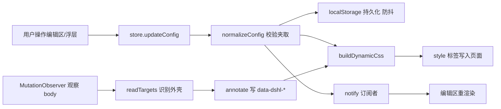
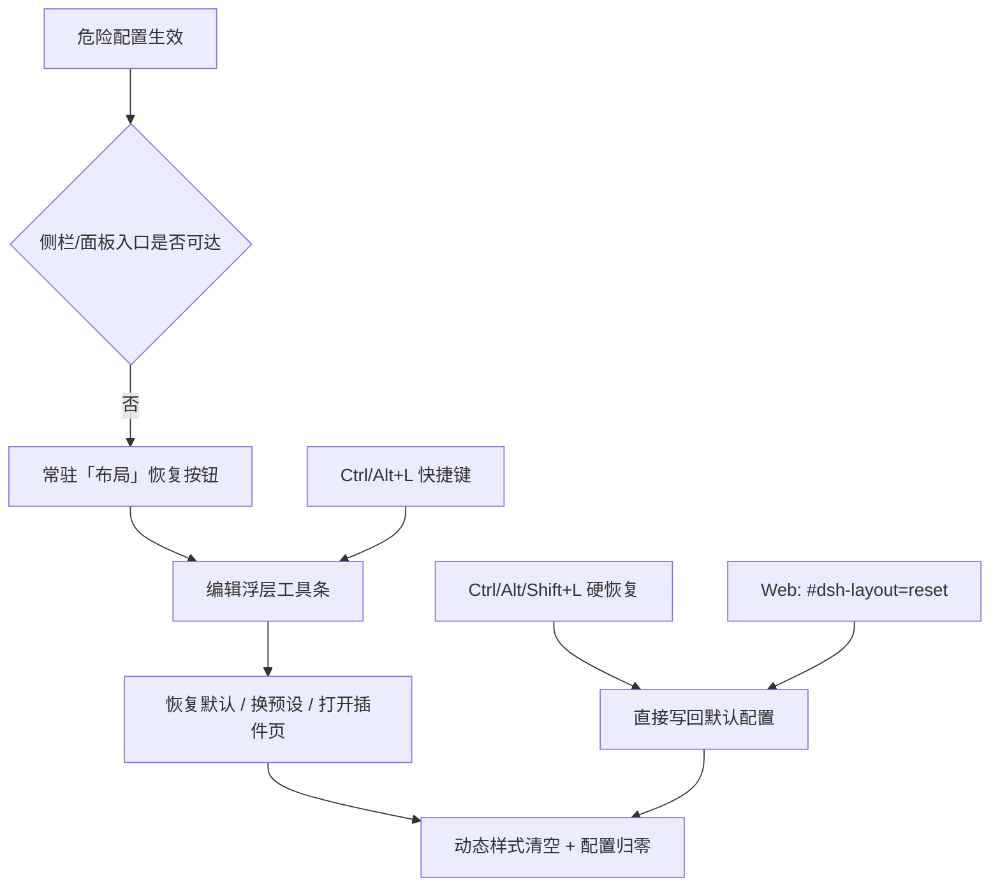

# 插件架构

## 组成

```text
bundle: dsh-layout（package.json 的 dsh.bundle.patch + dsh.client）
├─ Host 半边 index.js             只导出 apply()，占位；不注册服务、不写配置
└─ Client 半边 client.js          全部界面与布局逻辑
   ├─ 配置模型 / 本地持久化        localStorage: dsh-layout/config/v1
   ├─ DOM 注解器                   识别外壳结构，写 data-dshl-* 标记
   ├─ 样式引擎                     按配置生成 style[data-dsh-layout="dynamic"]
   ├─ plugins.detail.section 注册  插件详情页内的编辑区
   └─ shell.overlay 注册           编辑模式：列分隔条、区域框、浮动工具条
```



## 设计选择

1. **不替换宿主组件。** 宿主 `root` 单插槽里是 AppFrame，替换它就要重写三栏、抽屉、拖拽手柄、主题呈现等全部行为，且会连带影响所有依赖子插槽的插件。因此只做两件事：给宿主 DOM 打标记、用 CSS 覆盖几何。
2. **入口按需求放在插件详情页。** `plugins.detail.section` 的 owner props 带 `subject`（`kind: 'bundle' | 'row' | 'item'`），组件只在 `pkg.name === 'dsh-layout'` 时渲染，不会污染其它插件的详情页。
3. **编辑浮层常驻注册。** `shell.overlay` 是框架级浮层，编辑模式在任意页面都能操作；浮层根节点 `pointer-events:none`，只有手柄与工具条可点，不挡住会话。
4. **配置存本地。** 布局是纯客户端呈现偏好，不进会话日志、不进 Host 配置，因此不需要重启插件、不触发 profile 重载；代价是桌面端与浏览器端配置独立，用导出/导入跨端同步。
5. **读取时全量校验。** localStorage 与导入文件都属于不可信输入，统一走 `normalizeConfig`：枚举项去重、未知项丢弃、数值夹取到合法区间，旧版本缺字段用默认值补齐。

## 恢复通道（不可恢复状态防护）

布局可能改变「回到插件详情页」的路径，因此恢复能力必须独立于被改变的界面本身：



- 恢复按钮只在「入口可能不可达」时出现：隐藏侧栏、隐藏任一面板、隐藏全部侧栏区块、实测侧栏/面板行不可见、或中栏（插件详情页所在的 main 面板）被挤到屏幕外。正常状态下不额外占用界面。
- 快捷键与哈希重置不依赖浮层组件渲染，属于最后兜底；因此即使编辑浮层出问题也能恢复。
- 设置面板偏移在生成样式时按视口夹取，面板不可能被配置到屏幕外。
- 折叠态（`:not([data-sidebar-collapsed])` 门控）不叠加本插件列序，避免「宿主列宽 + 本插件列序」错位造成的不可点击。

## 与宿主的交互面

| 交互 | 方式 |
| --- | --- |
| 读外壳结构 | 只读 DOM：`[data-slot="..."]`、`[data-rightbar-col]`、`[data-sidebar-right-panel]`、`[data-conversation-content]`、`[data-shortcut-modal="settings"]`、`aria-label` |
| 改几何 | 只写 CSS：自身 style 标签 + `data-dshl-*` 属性；不写宿主 inline style、不改宿主 class |
| 导航与路由 | 不改；仍由宿主负责（左栏面板切换、会话打开、设置开关） |
| 其它插件 | 通过宿主插槽共存；本插件不读取其它插件的样式或组件 |

## 升级稳定性

- 优先依赖宿主稳定的 `data-*` 属性与 `data-slot` 名称；CSS module 哈希类名一律作为兜底而非首选。
- 识别失败时 `targets.ok === false`，编辑区显示「未识别界面结构」，动态样式为空，界面维持宿主默认。
- 所有生成样式都限定在 `[data-dshl-frame]` 或 `[data-dshl-*]` 之下，不产生全局选择器，卸载时连同两个 style 标签一起移除。
