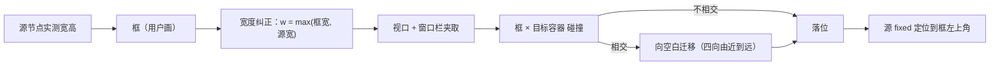

# 区域搬移：从「源 × 目标 × 位置」改为「画框」

## 背景

区域搬移做了五轮修补：形状兼容提示（第十一轮）、链式冲突剔除（第十二轮）、窗口栏避让（第十三轮）、槽位化重构（第十四轮）、槽位兼容方向修正（第十四轮补）。每轮都有效，但每轮之后仍有新组合失效。

用户判断机制本身有问题，并给出了替代方案：

> 既然它是投影，而非真搬移；那么我们其实可以获取到源单元的宽高尺寸，随后再将目标容器一项改成由用户可画框的形式，而这个画出来的框是一个中间层……我们不再计算源单元乘目标容器乘位置的量，而是仅计算源单元的各宽高与框，而框与目标容器进行计算，位置则是随着用户可画框消解。

这个判断是对的。原模型的组合空间：

```
源 22 × 目标 18 × 位置 2 = 792 种组合
```

每一轮补丁都在这个笛卡尔积上做减法（槽位化把它压到约 80），但**组合的存在本身就是问题**——目标容器与位置这两维，在「用户直接用鼠标指位置」的前提下根本不需要建模。

## 目标与验收标准

1. 搬移由「在界面上画一个框」发起，不再选目标容器、不再选开头/结尾。
2. 框只声明**位置与宽度**；源单元高度按内容自然展开（宽度跟框、高随内容）。
3. 框落在视口内、避开原生窗口栏；与目标容器求碰撞，冲突时向空白处迁移。
4. 槽位表、形状表、链式剔除、宽度压缩比判据全部删除——它们描述的是被移除的两个维度。
5. 旧配置不静默丢弃：保留并标「需重画」，提供一键清空。
6. 中英字典成对，键集合双向 0 缺失。

## 结论与依据

### 为什么删掉槽位表

`RELOCATE_SLOTS` 存在的唯一理由是：配置时不知道用户想把东西放哪，只能让它从 16 个已知容器里选一个，于是必须回答「这个源能不能进那个容器」。画框之后这个问题不存在——用户画出什么位置就是什么位置，宽度是画的，高度是内容的。

同理 `RELOCATE_SOURCE_SHAPES` 与 `RELOCATE_SHAPE_NEEDS` 只是给「能不能进」这个判定提供输入，一并删除。源不再需要白名单：任何有真实布局盒的单元都能被搬。

### 为什么去掉占位符

占位符是「让目标容器为源让出高度」的机制，它带来三处必然的复杂性：

- 源高度要反写进占位符高度，两者互相影响 → 帧循环要追 240 帧
- 目标容器自己也被搬走时占位符跟着飞 → 链式剔除
- 目标塌成 0 尺寸时占位符留下一条空白条 → 帧循环里的拆卸守卫

画框之后源**不进入任何容器的布局流**（它本来就是 fixed 投影），让位这件事没有意义——用户已经用框指定了位置，容器不需要为它腾地方。去掉之后上述三处复杂性同时消失。

代价说清楚：源压在容器内容上时会盖住内容。这个代价由「碰撞检测 + 向空白处迁移」承接，而不是由容器让位承接。

### 位置合法性怎么算

三个判据，全部是几何，不认识任何容器语义：

1. **视口夹取**：框整体落在 `[0, innerWidth] × [projectionTopBound(), innerHeight]` 内（上界避开原生窗口栏）。
2. **最小可读宽度**：框宽不得小于源的实测宽度（画窄了自动放大到源宽度）——这是「框不足以容纳源宽高时自动放大」的落地。
3. **碰撞迁移**：框与目标容器的矩形相交时，沿「上下左右四方向 + 由近到远」搜索第一个不碰撞的位置；实在找不到就保持用户画的位置并标出冲突。

高度不参与判据：源高度是内容的函数，框只给位置。

### 旧配置怎么办

`relocate` 的旧值是 `{ to, place }`，新值是 `{ frame: {x, y, w} }`。旧值没有位置信息，无法自动换算成框，因此：

- 保留旧条目，面板上标「需重画」并提供「重画」按钮进入画框模式
- 提供「清空全部需重画的搬移」
- 不静默删除（用户可能只是想稍后处理）

## 设计

### 配置形态

```js
relocate: {
  'block:brand': { frame: { x: 582, y: 310, w: 564 } },
}
```

`x/y` 是视口坐标（与投影的 fixed 定位同一坐标系），`w` 是框宽。归一化时按视口夹取，视口变化时按「保持相对位置」重投影。

### 运行时链路



### 与原有机制的保留关系

保留：fixed 投影本身（不动物件树）、窗口栏避让、源节点被 React 重建后重建投影、配置清理不残留空 style。

删除：占位符、链式剔除、形状表、槽位表、压缩比警告。

## 验证方式

- `node --check` 两个 bundle 语法
- `.tmp/probe-i18n-keys.py` 键集合双向 0 缺失
- 全文搜索确认无死引用（`RELOCATE_SLOTS` / `PLACEHOLDER_ATTR` / `relocateFit` 等）
- 真机走查由用户完成：给出预期效果与操作步骤

## 回滚方式

单次提交、改动集中在 `client.js` 的投影段与卡片段 + `client.board.js` 的控件段。回滚即 `git revert`。

## 第十七轮（完善：让画框真正好用）

用户走查通过后进入完善阶段，授权「增强可不经同意新增」。这一轮不改机制，只补交互与判定精度。

### 障碍层级自适应（真 bug）

`relocateObstacles` 原本固定取「区域的直接子元素」。但宿主不同区域的嵌套深度不一样——侧栏区域下面是 `[data-slot=sidebar]` 再套一层才是真正的块容器。这类区域于是退化成一个把整个区域都包住的障碍，**框落哪儿都碰撞**，自动让位等于永远失效。

改法 `relocateObstacleLevel`：某层只有一个实质子元素、且它几乎撑满父级（4px 容差）就判定为包裹层并下钻，最多 4 层，直到出现一组并列内容块。源自身及祖先链始终排除。

### 已有框可原地微调

原先「重画」是唯一入口，调 1px 也得整个重来。现在：

| 操作 | 行为 |
| --- | --- |
| 框内按住拖 | 整体平移（只改位置，不走宽度放大） |
| 拖右边缘 | 改宽度 |
| 方向键 / Shift+方向键 | 微调 1px / 10px |
| Enter / 「应用」 | 提交 |

`commitFrame` 新增 `mode='nudge'`：微调时宽度沿用配置值，否则每次都被「源原始宽」顶一次，框永远拖不窄。

### 三个交互坑

**框外按下不能立刻算「新画」。** 用户想挪一下却点偏几像素，旧框会被整个丢掉、回到从零画。改成先标 `outside` 待命，位移超过 6px 才承认另画一个。

**进画框要临时收起编辑面板**（面板会盖住要画的位置），但退出时恢复原开合状态，否则「调整一下」之后面板凭空消失。

**压暗只由主框承担**。多个框各带 `box-shadow: 0 0 0 9999px` 会叠成好几层，越拖越黑；影子框用 `:not([data-preview])` 排除。

### 落位影子

拖拽时实时画两层框：实线是用户画的框，虚线是自动让位后的真实落点（重合时不画）。松手前就知道东西最终落在哪。

### 诊断加「让位是否失效」

`__dshlDesktopProbe` 的 relocation 段新增 `host` 与 `overlapping`：落位矩形与该区域内已占内容再判一次相交。压住内容却无人报错是这套机制最容易静默失效的地方，现在会明确说「搬移 X 的落点仍与 N 块内容相交」。

### 验证

离线断言从 11 条扩到 **15 条**，新增 4 条覆盖下钻逻辑（单包裹下钻到并列块 / 平铺结构不下钻 / 非撑满的单子级不下钻 / 源自身排除）。全部通过；两 bundle 语法通过；中英字典 438/438 双向 0 缺失。

